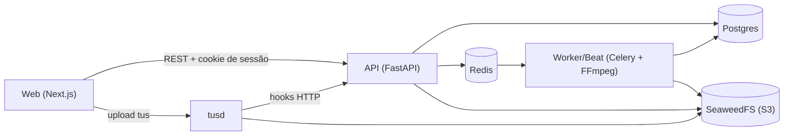

# Projeto Cortes e Vídeos IA

Aplicação para transformar vídeos longos em cortes verticais (Shorts, Reels, TikTok) e publicá-los nas plataformas por APIs oficiais, sempre com controle de direitos autorais.

Repositório: https://github.com/Jopei/projeto-cortes-e-videos-ia

> **AVISO DE DIREITOS AUTORAIS — leia antes de usar**
>
> Este projeto é destinado **somente** a conteúdo que você tem direito de cortar e republicar: material **próprio**, **licenciado**, de **domínio público** ou **Creative Commons que permita uso comercial e obras derivadas**.
>
> **Não existe "duração segura".** Cortar 5, 10 ou 30 segundos de um vídeo sem licença não torna o uso legal. A única proteção é ter a licença.
>
> Por isso o app tem uma **trava de direitos (rights gate)**: todo vídeo enviado precisa estar vinculado a uma **Fonte** (registro de licença), e nenhum corte entra na fila de publicação sem passar pela trava. Ela bloqueia:
>
> - licença ausente;
> - fora da janela de validade da licença;
> - plataforma não listada nas plataformas permitidas da licença;
> - CC-BY-NC quando a conta é monetizada;
> - CC-BY-ND sempre (um corte é obra derivada, e ND proíbe isso);
> - fonte sem permissão de monetização, quando a conta é monetizada.
>
> A regra vive em um único lugar (`services/api/app/rights/gate.py`) e uploads sem fonte são rejeitados antes de começar. A responsabilidade legal pelo conteúdo continua sendo sua.

## O que é

Você envia um vídeo (upload retomável), o app mede a intensidade de cada trecho, sugere os melhores momentos, gera os cortes em 1080x1920 com reframe e legendas, escreve título, descrição e hashtags por plataforma e agenda ou exporta a publicação. Suporta vários canais por usuário e vários usuários (admin e cotas).

Plataformas de destino: YouTube Shorts, TikTok, Instagram Reels, Facebook Reels, Vimeo e Bilibili (manual/exportação).

## Funcionalidades

- Upload retomável (tus) direto para armazenamento S3-compatível, com checagem de licença e cota.
- Análise de intensidade: áudio, cortes de cena, movimento e fala (transcrição com Whisper); refinamento opcional por IA (Claude).
- Presets de análise (ação, drama, comédia, suspense, personalizado) com pesos ajustáveis.
- Geração de cortes verticais 1080x1920 com reframe (auto, blur, centro) e legendas queimadas opcionais.
- Revisão: aprovar, rejeitar ou ajustar início/fim do corte (re-renderiza).
- Metadados por plataforma (título, descrição, hashtags), sempre com a atribuição da licença na descrição.
- Agendamento automático respeitando janelas de postagem e limite diário por conta.
- Exportação manual (zip com vídeo e metadados) para contas no modo manual.
- Multi-canais (nicho, template e defaults de análise por canal) e multiusuário (cada um vê só o seu; admin vê tudo e pode "ver como" outro usuário).
- Cotas por usuário (armazenamento, análises por dia, nº de canais), trilha de auditoria e revogação de sessões.
- Chaves das integrações cadastráveis pelo admin na própria interface.

## Arquitetura



API, worker e beat compartilham a mesma base de código (`services/api`); só a imagem do worker inclui FFmpeg, OpenCV, PySceneDetect e faster-whisper.

## Stack

- **API:** Python 3.12, FastAPI, SQLAlchemy 2, Alembic, pydantic-settings.
- **Worker:** Celery (Redis), FFmpeg, OpenCV, PySceneDetect, faster-whisper, SDK da Anthropic (opcional).
- **Web:** Next.js 14, React 18, Tailwind CSS, tus-js-client.
- **Infra:** Postgres 16, Redis 7, SeaweedFS (S3), tusd, Docker Compose.

## Como rodar localmente

### Pré-requisitos

Docker com Docker Compose. Para gerar as chaves abaixo, Python 3 com o pacote `cryptography` (`pip install cryptography`).

### 1. Configurar o `.env`

```bash
cp .env.example .env
```

Preencha, no mínimo:

| Variável | Para quê |
| --- | --- |
| `SECRET_KEY` | Assina as sessões. Obrigatória, 32+ caracteres e aleatória — a API não sobe sem ela nem com o valor de exemplo do `.env.example`. |
| `TOKEN_ENCRYPTION_KEY` | Chave Fernet que cifra tokens OAuth e chaves de integração no banco. |
| `ADMIN_USERNAME` / `ADMIN_PASSWORD` | Conta do primeiro admin (exemplo: `admin` / `troque-me` — troque a senha). |

Gerar as chaves:

```bash
python -c "import secrets; print(secrets.token_urlsafe(48))"
python -c "from cryptography.fernet import Fernet; print(Fernet.generate_key().decode())"
```

O restante do `.env.example` tem valores padrão funcionais para desenvolvimento local. Em produção troque também as credenciais do Postgres e do S3.

### 2. Subir os serviços

```bash
docker compose up -d --build
docker compose exec api alembic upgrade head
docker compose exec api python -m app.cli create-admin
```

O admin não é criado automaticamente no startup. O comando não sobrescreve uma senha existente; use `--reset` para trocá-la.

### Portas

Todas publicadas apenas em `127.0.0.1`; configuráveis no `.env`.

| Serviço | URL local | Variável |
| --- | --- | --- |
| Web | http://localhost:13000 | `WEB_HOST_PORT` |
| API | http://localhost:18000 | `API_HOST_PORT` |
| tusd (upload) | http://localhost:11080 | `TUSD_HOST_PORT` |
| SeaweedFS (S3) | http://localhost:19000 | `STORAGE_HOST_PORT` |
| Postgres | localhost:15432 | `POSTGRES_HOST_PORT` |
| Redis | localhost:16379 | `REDIS_HOST_PORT` |

Se mudar a porta da web ou da API, ajuste também `NEXT_PUBLIC_API_URL`, `NEXT_PUBLIC_TUS_URL`, `CORS_ORIGINS`, `TUSD_CORS_ORIGIN_REGEX` e `PUBLIC_API_URL`.

### Primeiro uso

1. Abra http://localhost:13000 e entre com o admin criado.
2. Crie um **canal** (nome, nicho, preset padrão).
3. Cadastre uma **licença** (Fonte): tipo, validade, plataformas permitidas e texto de atribuição.
4. Envie um vídeo vinculado a essa fonte.
5. Rode a **análise** e acompanhe o progresso.
6. **Revise** os cortes sugeridos: aprove, rejeite ou ajuste.
7. **Publique**: o rights gate roda por corte e conta. Contas manuais geram uma exportação; a publicação automática em contas OAuth ainda está pendente (ver Status).

## Configurar integrações

As chaves de cada plataforma podem ser cadastradas de duas formas; o valor salvo no banco tem prioridade sobre o `.env`:

- pela tela **Contas** (somente admin), sem reiniciar nada;
- pelas variáveis do `.env` (`YOUTUBE_CLIENT_ID`, `TIKTOK_CLIENT_KEY`, `INSTAGRAM_APP_ID`, `FACEBOOK_APP_ID`, `VIMEO_CLIENT_ID`, `BILIBILI_CLIENT_ID`, `ANTHROPIC_API_KEY` e os respectivos secrets).

Onde obter:

| Integração | Onde criar o app / chave |
| --- | --- |
| YouTube | Google Cloud Console (YouTube Data API v3, credencial OAuth) |
| TikTok | TikTok for Developers (Content Posting API) |
| Instagram e Facebook | Meta for Developers (Graph API) |
| Vimeo | developer.vimeo.com/apps |
| Bilibili | Open Platform (opcional; sem aprovação, use o modo manual/exportação) |
| IA (Claude) | Console da Anthropic (`ANTHROPIC_API_KEY`, opcional) |

Em cada app, registre a redirect URI `{PUBLIC_API_URL}/api/accounts/{plataforma}/callback` (a tela Contas mostra o valor exato). O padrão de `PUBLIC_API_URL` é `http://localhost:18000`.

Observações:

- O TikTok exige HTTPS na redirect URI: em desenvolvimento use um túnel (ngrok, cloudflared etc.) e ajuste `PUBLIC_API_URL`.
- YouTube e TikTok publicam como **privado** até o app passar pela auditoria da plataforma.
- Nunca cole chaves reais em issues, PRs ou commits.

## Testes

API (rights gate, auth, escopo multiusuário, cotas, canais, integrações etc.), com SQLite em memória:

```bash
cd services/api
python3 -m venv .venv
.venv/bin/pip install -r requirements-dev.txt
.venv/bin/pytest
```

Teste de integração (FFmpeg/OpenCV reais sobre um vídeo sintético), pulado por padrão. Precisa rodar no container `worker`, que tem essas dependências; o pytest não vem na imagem, então instale-o antes:

```bash
docker compose exec worker pip install pytest httpx
docker compose exec worker pytest -m integration
```

Web:

```bash
cd apps/web
npm install
npm run lint
npm run build
```

## Status e roadmap

Pronto:

- upload retomável com trava de direitos e cotas;
- análise de intensidade, geração de cortes verticais e metadados por plataforma;
- revisão de cortes, agendamento e exportação manual;
- canais, multiusuário, cotas e auditoria;
- cadastro de chaves de integração pelo admin.

Pendente:

- OAuth "Conectar" e publicação automática/retirada do ar nas plataformas (as rotas `/api/accounts/{plataforma}/connect|callback` retornam 501 hoje);
- módulo Encurtadores (aba "Em breve");
- upgrade do Next.js 14 para 15;
- segmentação de rede do tusd/API antes de expor publicamente (os hooks `post-finish`/`post-terminate` são alcançáveis sem cookie na rede interna; hoje validados por ticket HMAC);
- rate limit de login persistente (hoje é em memória, por processo).

## Estrutura

```
.
├─ docker-compose.yml
├─ .env.example
├─ apps/web/             # Next.js (interface)
└─ services/api/
   ├─ Dockerfile         # multi-stage: alvos `api` e `worker`
   ├─ alembic/           # migrations
   ├─ app/
   │  ├─ routers/        # endpoints (um por recurso)
   │  ├─ models/ schemas/
   │  ├─ rights/         # rights gate e atribuição
   │  └─ worker/         # tasks Celery, análise, render, metadados, publishers
   └─ tests/
```

Detalhes de contrato de API e decisões de design estão em `CLAUDE.md`.

## Segurança

- **Nunca** faça commit do `.env` (já está no `.gitignore`) nem de chaves, tokens ou senhas.
- Para reportar uma vulnerabilidade, abra uma issue ou contate o mantenedor, sem expor detalhes de exploração em público.
- A API e os serviços de apoio publicam portas só em `127.0.0.1`. Antes de expor o projeto na internet, coloque tusd e API atrás de um proxy e leia o item de segmentação de rede no roadmap.

## Contribuindo

Issues e PRs são bem-vindos. Rode os testes da API e o lint/build do web antes de abrir um PR, e não duplique a lógica do rights gate fora de `rights/gate.py`.

## Licença

A licença ainda não foi definida. Até que seja escolhida, todos os direitos são reservados.
